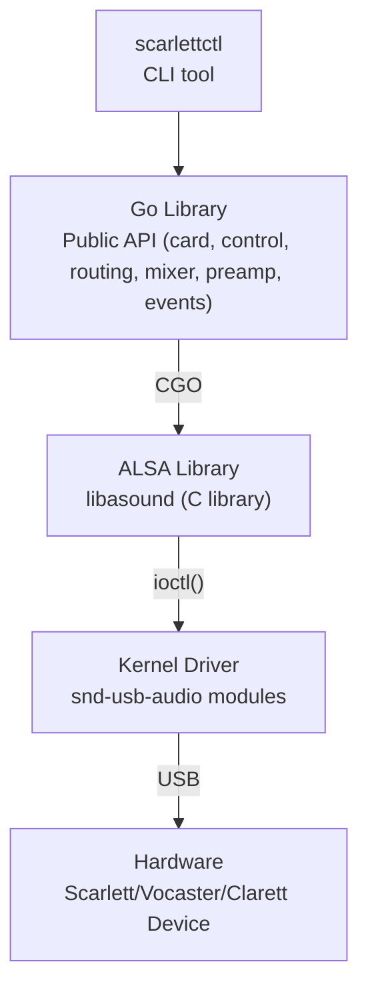

# scarlettctl - Development Guidelines

## Project Overview

This project provides a Go library and command-line tool for controlling Focusrite Scarlett, Vocaster, and Clarett USB audio interfaces on Linux via ALSA (Advanced Linux Sound Architecture).

### Components

1. **Core Library** (root directory) - Go package providing programmatic control of Scarlett devices
2. **scarlettctl** (`cmd/scarlettctl/`) - Command-line interface for device management and control

## Core Library Architecture

The library consists of 8 source files that provide comprehensive control over Scarlett audio interfaces:

### Source Files

- **`types.go`** - Core data structures (Card, Control, ControlType, RoutingSource, RoutingSink, PortCategory)
- **`card.go`** - Card discovery and management (OpenCard, ListCards, FindCard, Close)
- **`control.go`** - Control enumeration and manipulation (GetControls, FindControl, GetValue, SetValue)
- **`cgo.go`** - Low-level ALSA C library interface via CGO
- **`routing.go`** - Audio routing matrix management (GetRoutingSources, GetRoutingSinks, SetRouting)
- **`mixer.go`** - Internal mixer control (GetMixerInputs, SetMixerLevel, GetMixerLevel)
- **`preamp.go`** - Preamp channel control (GetPreampChannels, SetPreampGain, SetPreampPhantom, SetPreampAir)
- **`events.go`** - Real-time event monitoring (NewEventMonitor, Watch, WatchControls)

### Key Features

- **Cross-Generation Support**: Handles naming differences between Gen 1 and Gen 2/3/4 Scarlett devices
- **Type Safety**: Strong typing with validation for ranges and enum values
- **Pattern Matching**: Flexible control lookup by prefix or substring
- **Event-Driven**: Real-time monitoring of hardware and software control changes
- **Human-Readable**: String-based value setting (e.g., "on"/"off", enum names)

### Architecture



## CLI Tool (scarlettctl)

The command-line tool (`cmd/scarlettctl/`) provides access to all library features through a Cobra-based interface.

### Command Categories

**Device Management:**
- `list` - List all available Scarlett devices
- `controls <card>` - List all controls (use --verbose for current values)

**Control Operations:**
- `get <card> <control-name>` - Read control value
- `set <card> <control-name> <value>` - Write control value
- `watch <card>` - Monitor real-time control changes

**Routing Operations:**
- `routing <card>` - Display routing matrix
- `route <card> <sink> <source>` - Set routing connection

**Mixer Operations:**
- `mixer <card>` - Display mixer state

**Preamp Operations:**
- `preamp <card>` - Display preamp state
- `gain <card> <channel> <value>` - Set preamp gain (in dB)
- `phantom <card> <channel> <on|off>` - Control 48V phantom power

### Usage Examples

```bash
# List all Scarlett devices
./bin/scarlettctl list

# View all controls on card 0
./bin/scarlettctl controls 0 --verbose

# Set a control value
./bin/scarlettctl set 0 "Master Playback Volume" 50

# Monitor for changes
./bin/scarlettctl watch 0

# View routing matrix
./bin/scarlettctl routing 0

# Set preamp gain
./bin/scarlettctl gain 0 1 30
```

## Development Guidelines

### Dependencies

**Build Requirements:**
- Go 1.25+ (or latest stable)
- libasound2-dev (ALSA development headers)
- CGO enabled (required for C interop)

**Install on Ubuntu/Debian:**
```bash
sudo apt-get install libasound2-dev
```

**Install on Fedora/RHEL:**
```bash
sudo dnf install alsa-lib-devel
```

### Building

```bash
# Build CLI tool
go build -o bin/scarlettctl ./cmd/scarlettctl

# Build and install to $GOPATH/bin
go install ./cmd/scarlettctl

# Run tests
go test ./...

# Run with race detector
go test -race ./...
```

### CGO Considerations

This project uses CGO to interface with the ALSA C library. When developing:

1. **Headers Required**: Ensure `alsa/asoundlib.h` is available at compile time
2. **Dynamic Linking**: The compiled binary requires `libasound.so` at runtime
3. **Cross-Compilation**: CGO complicates cross-compilation; build on target platform or use appropriate toolchains
4. **Environment**: Set `CGO_ENABLED=1` if it's disabled in your environment

### Testing

**Hardware Testing:**
- Requires a physical Scarlett/Vocaster/Clarett device connected via USB
- Test on multiple device generations when possible (Gen 1, Gen 2/3/4)
- Verify control changes using `alsamixer` or `amixer` for validation

**Integration Testing:**
```bash
# Monitor events in one terminal
./bin/scarlettctl watch 0

# Change controls in another terminal
./bin/scarlettctl set 0 "Master Playback Volume" 75

# Verify event is detected in first terminal
```

### Code Style

- Follow standard Go conventions (`gofmt`, `go vet`)
- Document all exported functions and types
- Use meaningful error messages with context
- Prefer type safety over string comparisons where possible

## Binary Management

**IMPORTANT: Do not commit binaries to the repository.**

### Build Location

All compiled binaries should be placed in the `bin/` directory (already in `.gitignore`)

### Cleanup Practice

Always clean up binaries after building and testing:

```bash
# Clean up binaries
rm -rf bin/*

# Verify no binaries are staged
git status
```

### Before Committing

1. Run `git status` to verify no binaries are staged
2. Ensure `bin/` directory is not listed in changes
3. The `.gitignore` handles this automatically, but always verify

### Rationale

- Binaries are platform-specific and don't belong in version control
- They bloat the repository size unnecessarily
- They can be rebuilt from source at any time
- CI/CD systems build their own binaries from source

### Example Workflow

```bash
# Build
go build -o bin/scarlettctl ./cmd/scarlettctl

# Test
./bin/scarlettctl list
./bin/scarlettctl controls 0

# Clean up (REQUIRED before ending session)
rm -rf bin/*
```

## Documentation

Comprehensive documentation is available in `README.md`, including:

- Installation instructions for end users
- Complete CLI command reference with examples
- Library usage examples with Go code snippets
- API reference for all exported functions
- Troubleshooting guide for common issues
- Architecture and protocol details

When making changes, update `README.md` to reflect new features or API changes.

## Project Rules

1. in golang code, all comments should start with a lowercase letter, unless the first word of the sentence is referring to a golang type that starts with an uppercase letter.

2. all outputs logged or otherwise emitted to a user should prefer lowercase unless it is referring to a type that requires uppercase letters to express accurately. dynamic data in outputs should appear between single quotes, like "the user selected the 'value' setting", where `value` represents a variable.

3. golang files should be named like `dashManager.go` not `dash_manager.go`. unit tests should be named `dashManager_test.go`.

4. _never_ use emoji.
## Project memory

Durable knowledge about this project lives in `docs/journal/`, dated files `docs/journal/YYYY-MM-DD.md`. This is project memory; it does not go in harness-local storage (`.claude/` or equivalent), where it's invisible to every other harness and collaborator and dies with the host. Concretely: do not write to your harness's memory directory or memory tool for this project — even when the harness presents it as the default place for durable knowledge. That tool is the silo this convention exists to replace; the journal is the only durable home.

On arrival, read the most recent entries to pick up where the last session left off, before you start changing things. Treat them as prior-session context, not verified truth — if an entry conflicts with the code or a `docs/current/` doc, the code wins.

Write the smallest entry that carries the session's durable insight, and nothing more. The test for every line: *would a competent agent get this wrong, or waste time rediscovering it, working from the tree alone?* If it's recoverable by reading the code, the diff, `docs/current/`, or git history, leave it out.

That filter keeps four kinds of thing and discards the rest:

- **Decisions whose rationale isn't visible in the result** — why a value was chosen, what a line guards against, why something that looks like dead code or a no-op is load-bearing.
- **Deliberate non-actions** — a change you considered and chose not to make, so the next agent doesn't "fix" it. An unchanged file leaves no trace in a diff.
- **Couplings that span files** — two places that must move together, an ordering that matters, an assumption one file makes about another.
- **Live state** — what's unverified, unfinished, or waiting on something external.

Skip change inventories, restatements of the diff, and play-by-play of how you worked. There's no write-time approval gate; Michael reviews on commit. Append to the day's file if it exists, and write the few lines you'd want the next agent to read — honest and self-contained.

## Commits

The operator commits; agents don't. Never run `git commit` or `git push` in this repo. Finish the edit, leave the change in the working tree (staged is fine), report what changed, and hand off — the uncommitted diff is the review queue and the commit is the operator's act of acceptance. Approval of a change is not direction to commit; only an explicit instruction to commit is, and only for that commit.

## Roadmap

This repo's roadmap lives in `docs/future/roadmap/` — one frontmatter-markdown item per file, per the roadmap convention in the grimoire (software/conventions/roadmap-convention.md). You may add items freely: write the file directly with required `title`, `state: inbox`, and `created:` (today, YYYY-MM-DD), optional `tags`/`source`/`log`, and a body that is a small, clear prompt -- the problem or solution to execute, not documentation of it; trust the code and the day's journal entry for what's discoverable, and point a `log:` stamp at the specific journal entry when a card leans on hard-won context. Everything above the first `##` heading is the prompt; supporting material that isn't the prompt goes in named sections below it (`## why` for justification, `## background` for a longer description), which are conventional, never required, and never validated. The filename is the slug of the title (lowercase ASCII, hyphens; discard every other character); never overwrite an existing file. Read sibling items for the shape.

Hard rules: never touch `order.yaml` (priority is the operator's judgment, set at triage); never commit roadmap changes unless directed — the uncommitted diff is the review queue; never delete items; edits change only the lines that express them. Label the kind from the house set when one fits: defect, documentation, enhancement, epic, feature, story; add `spike` alongside it when the work carries unknowns that need discovery.
