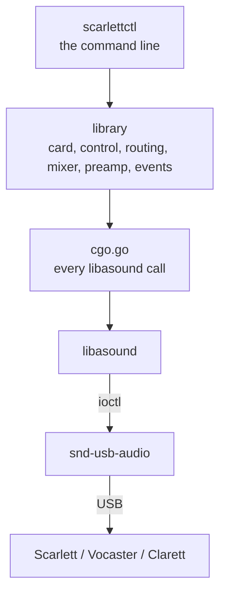

# The library

scarlettctl reaches the hardware through the ALSA control interface. The kernel's `snd-usb-audio` driver exposes a Scarlett's mixer, routing, and preamp as ALSA controls; libasound reads and writes them; the library types them.

A `Card` is an ALSA card number and name, opened into a private handle that `cgo.go` owns. Controls are enumerated from the card with their type, range, and enum items, and looked up by exact name, prefix, or substring, because Gen 1 and Gen 2/3/4 devices name the same controls differently. Reads and writes go through `GetValue` and `SetValue`; a write validates the range or resolves the enum item name first, so a caller can pass `on`, `off`, or an item's name.

The typed views sit on top of that. `routing.go` presents the routing matrix as sources and sinks; `mixer.go` the mixer inputs and their levels; `preamp.go` the per-channel gain, phantom power, air, pad, and impedance. `events.go` is the `EventMonitor`: it polls the card's descriptors and delivers control-change events, which is how a consumer follows changes made by other software or on the hardware.

The README is the user-facing reference for the CLI and the API. The roadmap carries the known gaps: the event monitor's stop flag is unsynchronized, and `Card` does not yet expose the hardware serial.
